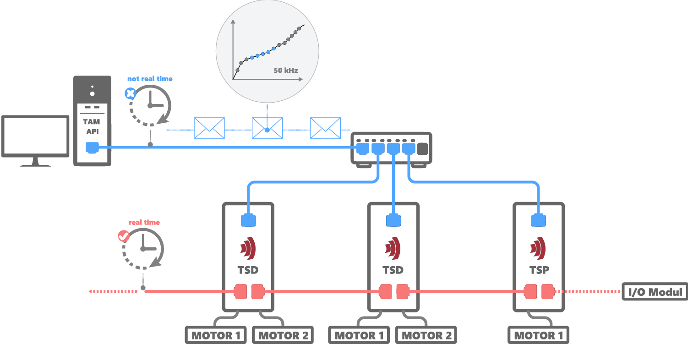
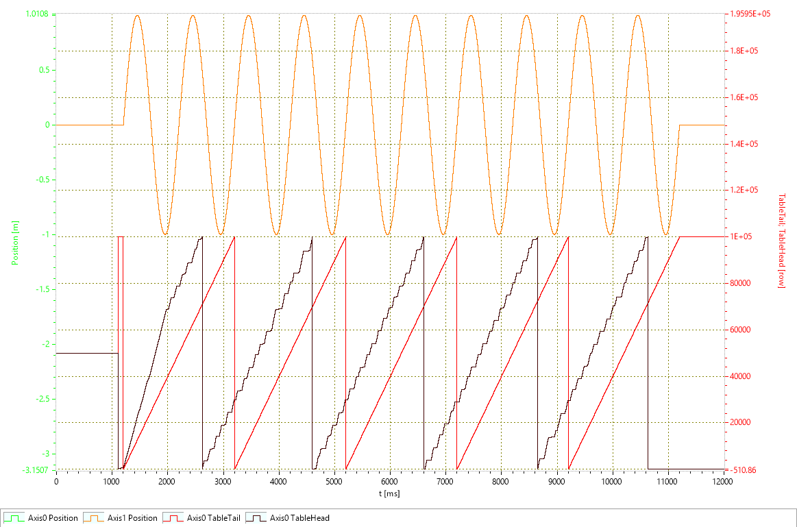
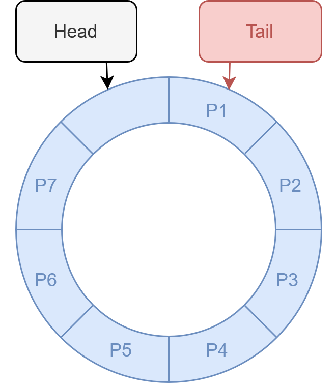

# TraSt-Sinus

This C# console application demonstrates trajectory streaming (TraSt) for motion control systems. It allows users to stream a sinusoidal path to a configurable number of axes over a user-defined duration.
The application continuously sends trajectory segments to the drives and provides feedback. At any time, the user can safely abort the streaming process by pressing q.

This example project illustrates how to use the TraSt feature of the TAM API and serves as a beginner-friendly introduction to basic trajectory streaming workflows.

## What is Trajectory Streaming
Trajectory streaming is a technique used to execute complex motion profiles in real time by separating path calculation from real-time execution.

In this application, a sinusoidal path is calculated on the host PC — but not in real time. Instead, the host divides the calculation into small segments, which are continuously sent to a ring buffer on the drive.
While the host continues calculating and sending new segments, the drive reads from the ring buffer in real time and executes the motion without delay. This enables high-frequency motion even though the host system itself is not real-time capable.
The TAM API manages the streaming process and ensures the buffer never overflows or underflows, allowing seamless real-time execution on the drive side.

The following image illustrates this workflow and shows the interaction between the host PC and the drive:

## View results in System Explorer
Visualizing the results can make understanding easier. The TAM System Explorer allows you to see what happens inside the application.
The following image shows two axes controlled by the application, moving along sinusoidal paths:

To understand the TableHead and TableTail, the following image may help:

  

The ring buffer (blue) is a fixed-size circular data structure where the end connects back to the start. On the drive, this ring buffer has many more entries than shown here. Data is written at the head and read from the tail. When either pointer reaches the end of the buffer, it wraps around to the beginning. The buffer is full when the head is about to overwrite unread data at the tail, and empty when the head and tail are at the same position.
In the System Explorer, the head is shown in black — always a bit ahead — and the tail in red, showing the current read position of the drive.

## How to Start
Before running the application, please ensure the following prerequisites:
* The drive runs firmware version 4.25.0-proto
* You have the correct feature key (e.g., xx-TS)
* The configuration files from this GitHub repository have been uploaded to your drive
